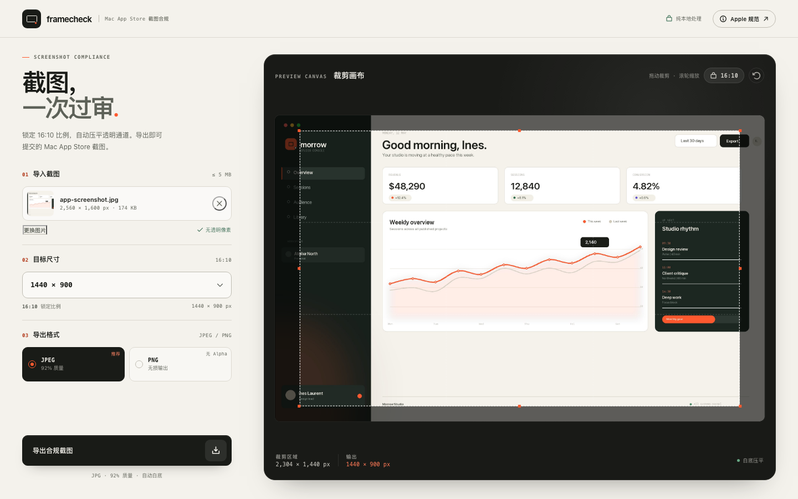

# Framecheck

为 Mac App Store 截图打造的一站式合规工具。纯前端处理，锁定 16:10，压平透明度，导出 Apple 审核要求的精确尺寸。



## 为什么需要它

Mac App Store 对截图有硬性限制：

- 只接受四种固定分辨率
- 强制 16:10 宽高比
- JPEG 或 PNG 格式
- 不允许 Alpha 通道或透明度
- 单个文件不超过 5MB

手动用 Preview 调整容易产生尺寸偏差、残留透明通道，也很难验证结果。Framecheck 把这些规则变成产品约束，让上传、裁剪、导出一次完成。

## 功能

- **上传校验**：检查 MIME、文件签名、5MB 大小上限与源图最小尺寸
- **透明检测**：扫描实际像素，提示透明区域会在导出时压平为白色
- **锁定裁剪**：16:10 比例不可更改，支持拖动图片、移动裁剪框、边角缩放、滚轮缩放
- **精确输出**：四档 Apple 尺寸任选，下载文件尺寸逐像素准确
- **无 Alpha PNG**：显式编码为 RGB 8-bit PNG，而不是浏览器默认的 RGBA
- **JPEG 体积控制**：默认 92% 质量，超过 5MB 时自动降质量
- **纯本地处理**：图片不会上传到服务器
- **响应式界面**：桌面工作台与移动端均可使用

## 支持尺寸

| 分辨率 | 宽高比 | 说明 |
|:---|:---|:---|
| 1280 × 800 | 16:10 | 紧凑尺寸 |
| 1440 × 900 | 16:10 | 默认，通用尺寸 |
| 2560 × 1600 | 16:10 | Retina |
| 2880 × 1800 | 16:10 | 高分辨率 |

## 技术栈

| 模块 | 技术 |
|:---|:---|
| 框架 | Vue 3 Composition API |
| 构建 | Vite 8 |
| 裁剪 | Cropper.js 2.3 |
| PNG 编码 | fast-png |
| 图标 | Phosphor Icons |
| 测试 | Playwright |
| 样式 | 原生 CSS |

## 本地运行

要求 Node.js `>= 20.19`。

```bash
npm install
npm run dev
```

打开 `http://127.0.0.1:4173`。

### 构建

```bash
npm run build
npm run preview
```

## 使用流程

1. 选择或拖入一张 JPEG / PNG 截图，文件不超过 5MB，尺寸至少 1280 × 800。
2. 选择目标分辨率。默认是 1440 × 900。
3. 拖动图片定位，拖动裁剪框或边角调整范围，滚轮缩放图片。
4. 选择 JPEG 或 PNG。
5. 点击「导出合规截图」，浏览器直接下载文件。

文件名规则：

```text
screenshot_{width}x{height}.jpg
screenshot_{width}x{height}.png
```

## 关键实现

### 16:10 裁剪

Cropper.js v2 使用 Web Components。裁剪框通过 `aspect-ratio="1.6"` 锁定比例，配合 `precise` 避免亚像素取整误差。图片移动、裁剪框移动、边角缩放都会继续遵守同一比例。

文档中提到的 `getCroppedCanvas` 是 Cropper.js v1 的 API。v2 对应的方法是：

```js
CropperSelection.$toCanvas({ width, height, beforeDraw })
```

### 透明压平

初始化裁剪前，将原图绘制到离屏 Canvas，逐像素检查 alpha 通道。存在透明像素时显示提示。

导出时通过 `beforeDraw` 在裁剪结果底部填充白色，再绘制图片，因此：

- JPEG 不会把透明区域压成黑色
- PNG 导出结果也是白底
- 源图透明区域不会残留

### PNG 无 Alpha

Canvas 的 `toBlob('image/png')` 通常会输出 RGBA PNG，即使所有 alpha 都是 255，文件仍带 Alpha 通道。Apple 会拒绝这类文件。

本项目读取 Canvas 像素后移除 alpha，再使用 `fast-png` 编码为 RGB PNG（color type 2）：

```js
encodePng({
  width,
  height,
  data: rgb,
  channels: 3,
  depth: 8,
})
```

### 精确尺寸

Cropper 会根据当前裁剪框比例计算输出尺寸。受浮点比例和取整影响，直接导出可能得到 2879 × 1800，而不是 2880 × 1800。

因此导出时有两层保护：

1. 裁剪框使用 `precise`，尽量保持精确的 16:10 比例。
2. 若生成 Canvas 与目标尺寸不一致，会再绘制到一张目标尺寸的白色 Canvas 中，保证输出逐像素精确。

### JPEG 体积控制

默认使用 0.92 质量。若结果超过 5MB，会依次尝试 0.90、0.86、0.82、0.78、0.74、0.70、0.64、0.58。若最终仍超过 5MB，界面会明确提示。

PNG 文件超过 5MB 时仍可下载，但会提示改用 JPEG。

### 上传校验

- `file.type` 必须为 `image/jpeg` 或 `image/png`
- 校验文件头的 JPEG / PNG 签名，防止改扩展名绕过
- 文件大小 `≤ 5MB`
- 实际像素尺寸宽高均 `≥ 1280 × 800`

校验失败会显示明确文案，并且不会初始化裁剪器。

## 验收标准

| 编号 | 测试项 | 预期结果 |
|:---|:---|:---|
| 1 | 上传 >5MB 文件 | 显示错误提示，不进入裁剪 |
| 2 | 上传 .gif 或 .webp | 显示格式错误提示 |
| 3 | 上传带透明 PNG | 显示透明提示，导出后背景为白色 |
| 4 | 选择 2880 × 1800 导出 | 下载文件尺寸精确为 2880 × 1800 |
| 5 | 拖拽裁剪框边角 | 宽高比始终锁定 16:10 |
| 6 | 导出 JPEG | 文件大小 ≤ 5MB，无透明度 |
| 7 | 导出 PNG | 格式正确，无 Alpha 通道 |
| 8 | 上传低于 1280 × 800 的图片 | 提示分辨率不足 |

## 测试

```bash
npx playwright install chromium
npm run test:e2e
```

测试会生成临时下载文件并验证：

- 输出尺寸
- PNG color type（必须为 2，即 RGB）
- 是否包含 `tRNS` 透明块
- 全透明源图导出后是否全部为白色
- 裁剪比例是否保持 16:10
- 切换目标尺寸时 Cropper 实例是否保持
- JPEG 文件是否小于 5MB

当前结果：**9 passed**。

## 项目结构

```text
src/
  App.vue                  # 应用状态、上传校验、导出流程
  components/
    CropStage.vue          # Cropper.js v2 裁剪画布
    SpecDialog.vue         # Apple 规范弹窗
  lib/
    constants.js           # 分辨率与限制常量
    image.js               # 校验、透明检测、编码与下载
  styles.css               # 全局设计变量与基础样式
tests/
  app.spec.js              # Playwright 端到端测试
  fixtures/                # 测试截图
docs/
  preview.png              # 界面预览
```

## 隐私

图片只通过 `URL.createObjectURL` 在浏览器内读取，不会发送到任何服务器。项目不存在后端接口或埋点脚本。

## License

[MIT](LICENSE)
